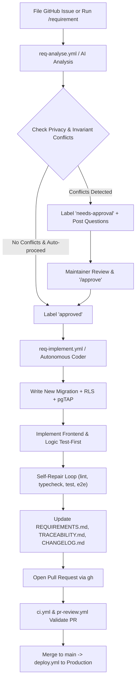

# Reusable Requirement-to-PR Workflow

LeaveEase features an autonomous development automation that converts plain-English business requirements into analysed, implemented, tested, and pull-requested code.



## How to File a Requirement

### Method 1: Using the GitHub Issue Template
1. Navigate to **Issues > New Issue** and choose **Requirement**.
2. Fill in the plain-English description, business context, priority, and optional auto-proceed checkbox.
3. The `req-analyse.yml` action automatically comments with an atomic `REQ-NNN` breakdown, impact analysis, and implementation checklist.

### Method 2: Running Locally in Google Antigravity
Execute the command in the chat or terminal:
```text
/requirement Managers should be able to delegate approvals to a colleague while on leave
```

## Guardrails (Strictly Enforced)
- Never disable Row-Level Security on any table.
- Never expose leave reasons in email templates, CSV exports, audit diffs, or logs.
- Never commit secrets or credentials.
- Schema changes must ALWAYS be new timestamped migrations.
- Max 3 self-repair loops for automated test execution.
